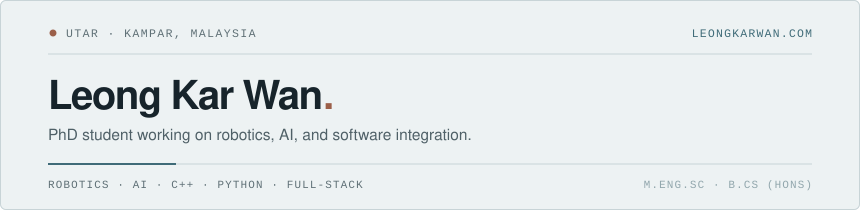

<a href="https://leongkarwan.com">
  <picture>
    <source media="(prefers-color-scheme: dark)" srcset="./assets/header-dark.svg" />
    <source media="(prefers-color-scheme: light)" srcset="./assets/header-light.svg" />
    
  </picture>
</a>

 

I'm pursuing a PhD at **Universiti Tunku Abdul Rahman (UTAR)** in Kampar, working on robotics, AI, and software integration. Before starting my PhD, I completed my M.Eng.Sc. in computer vision (license plate detection with object detection models) and worked as a full-stack app developer. On weekends, I build small tools and stream on YouTube.

### Currently working on

- **Robotics & embodied AI** — control, perception, and live software integration on humanoid hardware
- **Systems & software integration** — C++ and Python tooling, computer vision, and developer workflows
- **Personal web projects** — Next.js + Cloudflare Workers apps and [leongkarwan.com](https://leongkarwan.com)

### Selected work

| Project | Stack | What it is |
| --- | --- | --- |
| [`k1-oop-demo`](https://github.com/karwan5880/k1-oop-demo) | `C++` | Teaching OOP live on a Booster K1 humanoid — a 15-minute demo that moves a real robot |
| [`clock2`](https://github.com/karwan5880/clock2) | `Web` | Pocket — lightweight class reminders app |
| [`leongkarwan.com`](https://leongkarwan.com) | `Next.js · Workers` | Personal portfolio and PhD daily work log |

### Core stack

`C/C++` · `Python` · `TypeScript` · `React` · `Next.js` · `Cloudflare Workers` · `OpenCV` · `PyTorch` · `Linux` · `Docker`

---

[Website](https://leongkarwan.com) · [LinkedIn](https://linkedin.com/in/karwanleong) · [YouTube](https://youtube.com/@Lleongg5880) · [PhD Log](https://leongkarwan.com/phd)
